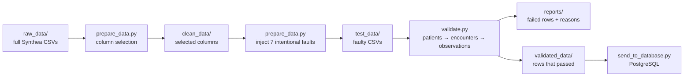
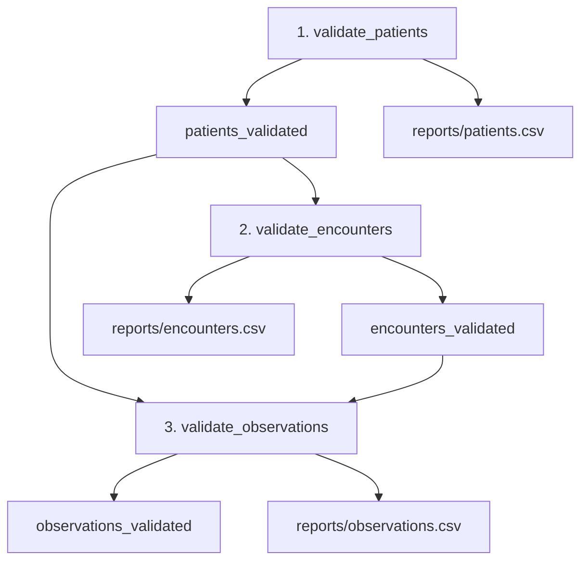
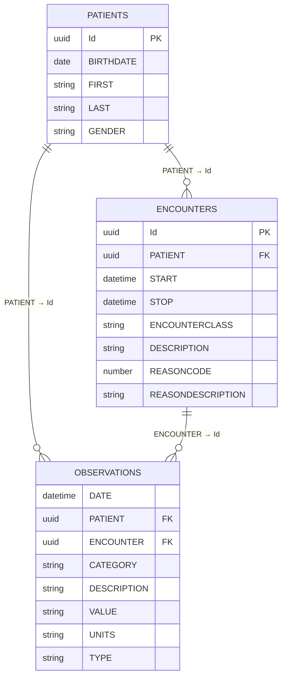

# Clinical Data Validation Pipeline

Healthcare data pipeline using Synthea-generated synthetic patient data, Python, SQL, and pytest. The pipeline selects a focused subset of clinical fields, injects known data-quality faults for testing, validates records (including cross-table referential integrity), writes validation reports and cleaned outputs, and optionally loads the validated data into PostgreSQL.

> All data in this project is **synthetic** (Synthea). It contains no real patient information.

---

## Pipeline overview



**Processing order matters.** Patients are validated first. Encounters and observations are then checked against both the original parent tables (existence) and the validated parent tables (referential integrity after filtering).



---

## Methodology

### Data resource: Synthea

[100 Sample Synthetic Patient Records, CSV](https://synthetichealth.github.io/synthea-sample-data/downloads/latest/synthea_sample_data_csv_latest.zip)

Jason Walonoski, Mark Kramer, Joseph Nichols, Andre Quina, Chris Moesel, Dylan Hall, Carlton Duffett, Kudakwashe Dube, Thomas Gallagher, Scott McLachlan, Synthea: An approach, method, and software mechanism for generating synthetic patients and the synthetic electronic health care record, Journal of the American Medical Informatics Association, Volume 25, Issue 3, March 2018, Pages 230–238, https://doi.org/10.1093/jamia/ocx079

### Original data (selected columns)

From the full Synthea exports in `raw_data/`, only the columns below are kept in `clean_data/` / `test_data/`:

| File | Columns |
| --- | --- |
| `patients.csv` | Id, BIRTHDATE, FIRST, LAST, GENDER |
| `encounters.csv` | Id, PATIENT, START, STOP, ENCOUNTERCLASS, DESCRIPTION, REASONCODE, REASONDESCRIPTION |
| `observations.csv` | DATE, PATIENT, ENCOUNTER, CATEGORY, DESCRIPTION, VALUE, UNITS, TYPE |

### Purposeful inconsistencies

Seven intentional faults are injected by `prepare_data.py` into `test_data/` so validation rules can be demonstrated and tested:

| Inconsistency | DataFrame | Index | What is wrong |
|---|---|---|---|
| 1 | patients | 9 | Missing Id |
| 2 | patients | 108 (last appended row) | Duplicate Id |
| 3 | encounters | 1 | Missing START |
| 4 | encounters | 19 | Invalid PATIENT ID |
| 5 | encounters | 0 | START and STOP switched |
| 6 | observations | 965 | Invalid ENCOUNTER ID |
| 7 | observations | 203 | VALUE does not match expected numeric type |

### Cross-table validation

In addition to individual column-level validation, the pipeline performs cross-table validation to ensure referential integrity between the three datasets.

The validation process follows this order:

1. **Patients** – patient records are validated first. Records containing validation errors are excluded from the validated dataset.
2. **Encounters** – encounter records are checked against the original patients dataset and the validated patients dataset. This identifies:
   - References to non-existent patients.
   - References to patients that exist in the original dataset but failed validation.
3. **Observations** – observation records are checked against both the original and validated patients and encounters datasets. This identifies:
   - References to non-existent patients or encounters.
   - References to patients or encounters that failed validation.

Records with cross-table validation errors are included in the validation report and excluded from the final validated dataset.

This approach helps ensure that the resulting datasets maintain referential integrity before being loaded into the database.

---

## File schemas

### Entity relationship (logical model)



### CSV column schemas and validation rules

#### `patients.csv`

| Column | Meaning | Constraints enforced |
| --- | --- | --- |
| `Id` | Patient UUID | Required; unique; parseable UUID |
| `BIRTHDATE` | Date of birth (`YYYY-MM-DD`) | Required; valid date; not in the future |
| `FIRST` | First name | Required (non-blank) |
| `LAST` | Last name | Required (non-blank) |
| `GENDER` | Sex/gender code | Required; must be one of `M`, `F`, `O` |

#### `encounters.csv`

| Column | Meaning | Constraints enforced |
| --- | --- | --- |
| `Id` | Encounter UUID | Required; unique; parseable UUID |
| `PATIENT` | FK → `patients.Id` | Required; must exist in original patients; must also exist in validated patients |
| `START` | Encounter start (`YYYY-MM-DDTHH:MM:SS±HHMM` / `Z`) | Required; valid timezone-aware datetime |
| `STOP` | Encounter end | Optional; if present, valid datetime and not before `START` |
| `ENCOUNTERCLASS` | Encounter class (e.g. wellness) | Carried through; not rule-validated |
| `DESCRIPTION` | Encounter description | Carried through; not rule-validated |
| `REASONCODE` | Reason code | Carried through; not rule-validated |
| `REASONDESCRIPTION` | Reason text | Carried through; not rule-validated |

#### `observations.csv`

| Column | Meaning | Constraints enforced |
| --- | --- | --- |
| `DATE` | Observation timestamp | Required; valid timezone-aware datetime |
| `PATIENT` | FK → `patients.Id` | Required; must exist in original and validated patients |
| `ENCOUNTER` | FK → `encounters.Id` | Optional; if present, must exist in original and validated encounters |
| `CATEGORY` | Observation category | Required; must be one of `laboratory`, `survey`, `vital-signs`, `social-history`, `exam`, `imaging`, `procedure`, `therapy` |
| `DESCRIPTION` | What was measured/observed | Carried through; not rule-validated |
| `VALUE` | Observed value (stored as text in CSV) | Required |
| `UNITS` | Unit of measure | Carried through; not rule-validated |
| `TYPE` | Declared value datatype | Required; must match inferred datatype of `VALUE` (`numeric` or `text`) |

### Report CSV schema

Each file under `reports/` contains every failing row (one row per failure reason; the same source row may appear more than once if it fails multiple rules), plus:

| Extra column | Meaning |
| --- | --- |
| `DF` | Source dataframe name (`patients` / `encounters` / `observations`) |
| `Index` | Row index in the input dataframe |
| `Reason` | Human-readable validation failure message |

### PostgreSQL schema (`send_to_database.py`)

Validated CSVs are loaded into a local database `clinical_data` with these tables:

| Table | Columns |
| --- | --- |
| `patients` | `id` (SERIAL PK), `patient_id` (UUID UNIQUE), `birthdate`, `first_name`, `last_name`, `gender` |
| `encounters` | `id` (SERIAL PK), `encounter_id` (UUID UNIQUE), `patient_id`, `start_time`, `stop_time`, `encounter_class`, `description`, `reason_code`, `reason_description` |
| `observations` | `id` (SERIAL PK), `patient_id`, `encounter_id`, `date`, `category`, `description`, `value`, `units`, `type` |

CSV ↔ DB name mapping: `Id` → `patient_id` / `encounter_id`, `FIRST` → `first_name`, `LAST` → `last_name`, `START`/`STOP` → `start_time`/`stop_time`, `ENCOUNTERCLASS` → `encounter_class`, etc.

---

## Repository layout

| Path | Role |
| --- | --- |
| `raw_data/` | Original Synthea sample CSVs (full column set) |
| `clean_data/` | Same records with only the selected clinical columns |
| `test_data/` | Clean data plus the 7 intentional inconsistencies |
| `validated_data/` | Rows that passed all validation rules |
| `reports/` | Failed rows with `Reason` explanations |
| `prepare_data.py` | Load raw → select columns → inject faults → write `clean_data/` and `test_data/` |
| `validate.py` | Run patient / encounter / observation validation; write reports and validated CSVs |
| `utils.py` | UUID, date/datetime, and datatype helpers |
| `reporting_utils.py` | Build reports, collect error indices, filter validated rows |
| `send_to_database.py` | Create PostgreSQL tables and insert `validated_data/` |
| `tests/` | pytest coverage for preparation, validation, utils, and reporting |
| `adjust_data.ipynb` | Exploratory notebook for inspecting / adjusting data |
| `investigate_results.ipynb` | Notebook for reviewing validation outcomes |

Approximate row counts in the current sample run:

| Stage | patients | encounters | observations |
| --- | ---: | ---: | ---: |
| `clean_data` | 108 | 5,571 | 68,648 |
| `test_data` | 109 (+1 duplicate) | 5,571 | 68,648 |
| `validated_data` | 107 | 5,532 | 64,203 |
| `reports` (failure rows) | 2 | 39 | 4,850 |

---

## How to run

### Prerequisites

- Python 3
- PostgreSQL (only for the database step), with `DB_PASSWORD` set
- Default DB connection in `send_to_database.py`: database `clinical_data`, user `postgres`, host `localhost`, port `5434`

### Steps

```bash
# Install dependencies
pip install -r requirements.txt

# 1) Build clean_data/ and test_data/ from raw_data/
python prepare_data.py

# 2) Validate test_data/ → write reports/ and validated_data/
python validate.py

# 3) (Optional) Load validated_data/ into PostgreSQL
export DB_PASSWORD='your_password'
python send_to_database.py

# 4) Run unit tests
pytest
```

---

## Results

### Patients report

| Validation rule number | Validation rule | DataFrame | Inconsistency detected? | Inconsistency number | Affected rows | Investigation status |
|---|---|---|---|---|---|---|
| Validation rule 1 | `Id` cannot be null | patients | Yes | 1 | 1 (index 9) | Expected — intentional. Missing `Id` at index 9. |
| Validation rule 2 | `Id` cannot be duplicated | patients | Yes | 2 | 1 (index 108; duplicate of an existing ID) | Expected — intentional. Duplicate `Id` at index 108. |
| Validation rule 3 | `Id` must be a valid UUID | patients | - | - | - | No findings reported. |
| Validation rule 4 | `BIRTHDATE` cannot be null | patients | - | - | - | No findings reported. |
| Validation rule 5 | `BIRTHDATE` must be a valid date | patients | - | - | - | No findings reported. |
| Validation rule 6 | `BIRTHDATE` must not be in the future | patients | - | - | - | No findings reported. |
| Validation rule 7 | `FIRST` cannot be null | patients | - | - | - | No findings reported. |
| Validation rule 8 | `LAST` cannot be null | patients | - | - | - | No findings reported. |
| Validation rule 9 | `GENDER` cannot be null | patients | - | - | - | No findings reported. |
| Validation rule 10 | `GENDER` must belong to the allowed set | patients | - | - | - | No findings reported. |

### Encounters report

| Validation rule number | Validation rule | DataFrame | Inconsistency detected? | Inconsistency number | Affected rows | Investigation status |
|---|---|---|---|---|---|---|
| Validation rule 11 | `Id` cannot be null | encounters | - | - | - | No findings reported. |
| Validation rule 12 | `Id` cannot be duplicated | encounters | - | - | - | No findings reported. |
| Validation rule 13 | `Id` must be a valid UUID | encounters | - | - | - | No findings reported. |
| Validation rule 14 | `PATIENT` cannot be null | encounters | - | - | - | No findings reported. |
| Validation rule 15 | `PATIENT` must reference an existing patient | encounters | Yes | 1, 4 | 37 records | Explained — 36 downstream failures caused by inconsistency 1, where patient Id was removed from `patients`, plus 1 intentional inconsistency 4 at index 19. |
| Validation rule 16 | `START` cannot be null | encounters | Yes | 3 | 1 (index 1) | Expected — intentional. Missing `START` at index 1. |
| Validation rule 17 | `START` must be a valid datetime | encounters | - | - | - | No findings reported. |
| Validation rule 18 | `STOP`, if present, must be a valid datetime | encounters | - | - | - | No findings reported. |
| Validation rule 19 | `STOP` must not be before `START` | encounters | Yes | 5 | 1 (index 0) | Expected — intentional. `START` and `STOP` were switched at index 0. |
| Validation rule 20 | `PATIENT` must reference a patient that passed validation | encounters | - | - | - | To be determined — identifies references to patients that exist in the original dataset but failed patient validation. |

### Observations report

| Validation rule number | Validation rule | DataFrame | Inconsistency detected? | Inconsistency number | Affected rows | Investigation status |
|---|---|---|---|---|---|---|
| Validation rule 21 | `DATE` cannot be null | observations | - | - | - | No findings reported. |
| Validation rule 22 | `DATE` must be a valid datetime | observations | - | - | - | No findings reported. |
| Validation rule 23 | `PATIENT` cannot be null | observations | - | - | - | No findings reported. |
| Validation rule 24 | `PATIENT` must reference an existing patient | observations | Yes | 1 | 397 records | Explained — downstream effect of the patient ID removed from `patients`. These records reference a patient ID that no longer exists in the parent table. |
| Validation rule 25 | `ENCOUNTER`, if present, must reference an existing encounter | observations | Yes | 6 | 1 (index 965) | Expected — intentional. Invalid `ENCOUNTER` ID at index 965. |
| Validation rule 26 | `CATEGORY` cannot be null | observations | Yes | External | 3,060 unique records | Observed — records associated with QALY, DALY, QOLS, or similar measures have missing categories. Requires confirmation against source data expectations. |
| Validation rule 27 | `CATEGORY` must belong to the allowed set | observations | - | - | - | No findings reported. |
| Validation rule 28 | `VALUE` cannot be null | observations | - | - | - | No findings reported. |
| Validation rule 29 | `TYPE` cannot be null | observations | - | - | - | No findings reported. |
| Validation rule 30 | `TYPE` must correspond to the datatype of `VALUE` | observations | Yes | 7, External | 1 intentional record (index 203); 1,001 additional records requiring investigation | Expected — intentional mismatch at index 203 (`VALUE = 'eighty'`, `TYPE = 'numeric'`). The other 1,001 mismatches are not explained by the intentional inconsistencies. Their values appear numeric, and they should describe numerical observations. |
| Validation rule 31 | `PATIENT` must reference a patient that passed validation | observations | - | - | - | To be determined — identifies references to patients that exist in the original dataset but failed patient validation. |
| Validation rule 32 | `ENCOUNTER`, if present, must reference an encounter that passed validation | observations | Yes | 1, 4 | 390 | Explained — downstream effect of the patient ID removed from `patients`. Such patients' encounters were invalidated in encounters report, thus invalidated in the observations table. |
